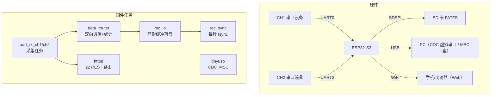
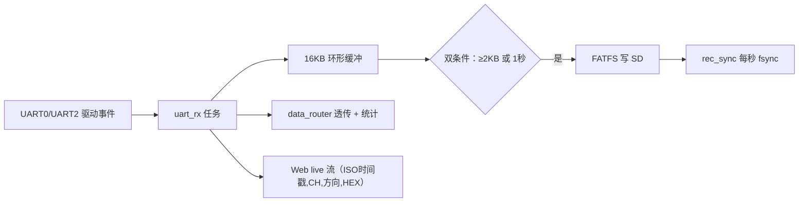

# 维特智能 ESP32-S3 双路串口 WiFi 数据记录仪

> 面向客户定制的「串口黑匣子」：接在两台串口设备之间，把两路 UART 原始字节流实时写入 SD 卡，同时用 WiFi（AP+STA）提供网页实时监控/启停/文件管理，用 USB CDC+MSC 复合设备提供一条 USB 线的调试与取数通道。

| 项目速览 | 内容 |
|---|---|
| 核心平台 | **ESP32-S3**（双核 Xtensa LX7 @240 MHz）+ ESP-IDF 5.4 |
| 开发语言 | C（固件）+ Python（报告生成脚本）；Flutter App 源码未入库 |
| RTOS | **FreeRTOS**（100 Hz tick；5+ 任务：uart_rx_ch1/ch2、rec_io、rec_sync、tinyusb、httpd） |
| 核心技术 | 双 UART 采集、16KB 环形缓冲 + 双条件落盘 + fsync、SD FATFS、USB CDC/MSC 复合设备、WiFi AP+STA、HTTP REST、NVS 配置 |
| 我的职责 | 双通道数据接入、数据路由、SD 落盘、文件管理 API、参数持久化（同事负责 Web 实时监控） |
| 项目状态 | 部分实机验证通过（SD/WiFi/Web/落盘/USB 热插拔 ✓，作者 8.4 记录）；双路串口端到端验证当时进行中【待本人确认】 |

## 1. 项目简介

客户设备对外只有 USB 口、没有标准串口接口，需要一款"插进去就能记录"的数据记录仪：设备 AP+Station 双模工作，串口数据双向透传 + SD 卡记录 + 网页配置监控 + USB 模拟 U 盘取数。项目按版本迭代交付：**v1.1（双路 UART 接入）→ v1.2（USB CDC/MSC 复合设备 + 容错加固）→ v1.2_dev（USB 桥接）→ v1.3（cdc 测试协议/时间同步/安全测试模式）**。

> ⚠️ 版本边界（务必如实）：v1.1 / v1.1_full_features / v1.2 源码在仓库；**v1.2_dev 与 v1.3 是空 gitlink，源码未入库**——v1.3 功能据 README 自述，无法逐行取证【待本人确认】。Flutter App 同样只有环境文档、无源码。

## 2. 项目演示 / 效果

- [USB CDC/MSC 硬件验证截图](screenshots/V1.2_USB_CDC_MSC_硬件验证成功.png)（文件名即"硬件验证成功"）
- 作者实习记录（8.4 实机验证）：SD 卡 SPI 挂载 ✓、WiFi AP 热点 ✓、Web 管理页面 ✓、双条件落盘 + fsync 实机正常 ✓、USB 复合设备热插拔切换 ✓
- 7.30 单点微测：CH2→CH1 路由 1 字节、丢包 0（**非吞吐曲线，严禁引申为性能数据**）
- 交付文档：[完整技术报告](docs/ESP_Recorder_项目开发完整报告.md)（8 章 + 4 附录）

## 3. 核心功能

| 功能 | 实现方式 |
|---|---|
| 双路 UART 采集 | CH1=UART0（TX43/RX44）、CH2=UART2（TX17/RX18），缓冲 2048，8N1/115200 |
| 双向透传 | CH1↔CH2 数据路由 + 字节/丢包统计（data_router.c） |
| SD 卡记录 | SDSPI（SPI2，CS10/MOSI38/MISO40/SCK39，20 MHz）+ FATFS，双文件 REC_CH1/REC_CH2 |
| USB 复合设备 | TinyUSB CDC（虚拟串口）+ MSC（U 盘读卡器），VID 303A / PID 4002 |
| Web 监控 | AP+STA WiFi + httpd，22 个 REST 路由，200 ms 增量轮询实时数据 |
| 参数持久化 | NVS 主存储 + cJSON，配置异常自动回滚 |

## 4. 技术栈

| 类型 | 技术 | 为什么选它 |
|---|---|---|
| MCU | ESP32-S3 | 原生 USB OTG + WiFi 双模，一颗芯片覆盖"采集 + 无线 + USB 取数" |
| 固件框架 | ESP-IDF 5.4（组件化 CMake） | 官方生态成熟，UART/SD/USB/WiFi 驱动齐全 |
| RTOS | FreeRTOS | ESP-IDF 默认调度；采集/落盘/同步/网络任务天然解耦 |
| 存储 | SD（SPI）+ FATFS | 无需专用 SDMMC 引脚，SPI 总线即可挂 FAT 文件系统 |
| USB | TinyUSB CDC+MSC | 复合设备枚举，U 盘模式免驱取数 |
| 网络 | WiFi AP+STA + httpd | AP 供现场手机直连，STA 连外网；REST 便于网页与脚本控制 |
| 工具 | Python 报告脚本 | 交付报告从代码自动生成，内容与代码强绑定 |

## 5. 系统总体架构



## 6. 软件架构

入口 `app_main()`：初始化 NVS→UART×2→SD→USB→WiFi→httpd→启动 FreeRTOS 任务。USB 热插拔回调里做 SD 所有权切换（MSC 挂载时停记录、卸载 FATFS 保留块设备；拔出后重挂载恢复记录）。

| 任务 | 优先级 | 栈 | 职责 |
|---|---|---|---|
| uart_rx_ch1 / ch2 | 5 | 4096 | 双路 UART 事件消费，数据进路由/缓冲 |
| rec_io | 5 | 4096 | 环形缓冲→SD 落盘（≥2KB 或 1 秒触发） |
| rec_sync | 1 | 3072 | 每秒 fsync，保证掉电丢失窗口有界 |
| tinyusb | 5 | 4096 | CDC+MSC（绑定 CPU1） |
| httpd | — | 16384 | Web 服务 + 实时数据轮询 |

同步原语：`s_mutex`（记录状态）、`s_data_sem`（有数据可落盘）、EventGroup（WiFi 状态）、portMUX（ISR 与任务共享）。

## 7. 核心数据流



- **落盘可靠性三层**：攒批（降写放大）→ 双条件触发（兼顾时延与寿命）→ 每秒 fsync（限定掉电丢失窗口）；
- **USB 与 SD 互斥**：同一张卡不能让 FATFS 与 USB MSC 同时访问——挂载 U 盘时只卸载 FATFS 层、块设备留给 MSC；拔出后 remount 恢复记录。

## 8. 核心模块讲解

### 8.1 记录引擎 data_recorder（核心）
16 KB 环形缓冲 + 双条件落盘 + fsync，见 [data_recorder.c](firmware/esp_recorder_v1.2/main/data_recorder.c)。为什么双条件：只有字节数阈值会在低流量时长期不落盘，只有定时会在高流量时频繁小写——两者取或。

### 8.2 双路 UART 驱动
[uart_driver.c](firmware/esp_recorder_v1.2/main/uart_driver.c)：CH1=UART0、CH2=UART2，支持波特率/数据位/停止位/校验位热配置（适配未知波特率传感器），带字节/丢包统计。

### 8.3 USB CDC+MSC 复合设备
[usb_cdc.c](firmware/esp_recorder_v1.2/main/usb_cdc.c) + [usb_msc.c](firmware/esp_recorder_v1.2/main/usb_msc.c)：TinyUSB 复合描述符 + SCSI READ10/WRITE10。

### 8.4 WiFi 与 Web
[wifi_config.c](firmware/esp_recorder_v1.2/main/wifi_config.c)：AP+STA 混合、STA 断线自动重连；[web_server.c](firmware/esp_recorder_v1.2/main/web_server.c)：22 个 REST 路由 + 路径穿越防护 + 200 ms 增量轮询（`/api/stream?since=N`）。

### 8.5 配置管理
[config_manager.c](firmware/esp_recorder_v1.2/main/config_manager.c)：NVS 主存储 + cJSON，读取失败自动回滚默认值。

## 9. ⭐ 核心代码导览

| 文件 | 作用 | 推荐程度 |
| --- | --- | --- |
| [app_main.c](firmware/esp_recorder_v1.2/main/app_main.c) | 入口、初始化顺序、USB 热插拔回调 | ⭐⭐⭐⭐⭐ |
| [data_recorder.c](firmware/esp_recorder_v1.2/main/data_recorder.c) | 环形缓冲 + 双条件落盘 + fsync（核心） | ⭐⭐⭐⭐⭐ |
| [data_router.c](firmware/esp_recorder_v1.2/main/data_router.c) | CH1↔CH2 双向透传 + 统计 | ⭐⭐⭐⭐⭐ |
| [uart_driver.c](firmware/esp_recorder_v1.2/main/uart_driver.c) | 双 UART 驱动与热配置 | ⭐⭐⭐⭐ |
| [sd_card.c](firmware/esp_recorder_v1.2/main/sd_card.c) | SDSPI+FATFS 挂载/卸载/重挂载 | ⭐⭐⭐⭐ |
| [usb_cdc.c](firmware/esp_recorder_v1.2/main/usb_cdc.c) | CDC 虚拟串口 | ⭐⭐⭐⭐ |
| [usb_msc.c](firmware/esp_recorder_v1.2/main/usb_msc.c) | MSC U 盘 + SCSI 回调 | ⭐⭐⭐⭐ |
| [wifi_config.c](firmware/esp_recorder_v1.2/main/wifi_config.c) | AP+STA + 断线重连 | ⭐⭐⭐ |
| [web_server.c](firmware/esp_recorder_v1.2/main/web_server.c) | 22 REST 路由 + 路径穿越防护 | ⭐⭐⭐⭐ |
| [config_manager.c](firmware/esp_recorder_v1.2/main/config_manager.c) | NVS + cJSON + 回滚 | ⭐⭐⭐ |

推荐阅读路径：**app_main → data_recorder → data_router → sd_card → usb_cdc/usb_msc → web_server**，一条"数据从哪来、怎么存、怎么取"的完整链路。

## 10. 关键技术实现

1. **双条件落盘 + 每秒 fsync**：见 8.1，掉电丢失窗口被限制在秒级；
2. **USB MSC 与 SD 所有权互斥**：只卸载 FATFS 保留块设备（[sd_card.c](firmware/esp_recorder_v1.2/main/sd_card.c)），解决"一边记录一边当 U 盘"的文件系统冲突；
3. **200 ms 增量轮询替代 WebSocket**：任务书要求 WebSocket，实际用 `since` 增量拉取——实现简单、断连幂等、无需长连接状态；代价是推送延迟 200 ms（对监控场景可接受）；
4. **路径穿越防护**：Web 下载接口限制在记录目录内；
5. **配置回滚**：NVS 读取失败自动回退默认配置，保证设备永不因配置损坏起不来；
6. **双向路由统计**：字节计数 + 丢包统计，把"透传"变成可验证的功能。

## 11. 技术难点

- USB CDC/MSC 复合设备与 SD 卡的所有权互斥（见 10.2）；
- 高速 UART 数据落盘不阻塞接收（环形缓冲 + 任务解耦 + 背压）；
- WiFi AP 永远在线 + STA 断线重连互不干扰；
- 掉电瞬间的数据完整性（fsync 策略）；
- 前后端 API 对齐（v1.1 前端曾调用不存在的后端路由，v1.2 补齐）。

## 12. 问题与解决方案

### 12.1 尾部缓存未落盘【已修复】
现象：停止记录时缓冲中数据丢失；根因：早期 flush 依赖运行标志的时序问题；方案：v1.2 停止路径强制 flush 缓冲（作者 7.28 记录 + [data_recorder.c](firmware/esp_recorder_v1.2/main/data_recorder.c)）。

### 12.2 Web 输入 ID 冲突【已修复】
现象：页面控制与数据通道 ID 撞车；方案：v1.2 统一 ID 命名与路由（作者 7.28 记录）。

### 12.3 USB CDC/MSC 描述符冲突【已修复】
现象：复合设备枚举失败；方案：修正复合描述符（作者 7.28 记录 + [usb_cdc.c](firmware/esp_recorder_v1.2/main/usb_cdc.c)）；硬件验证截图见 [screenshots](screenshots/V1.2_USB_CDC_MSC_硬件验证成功.png)。

### 12.4 ⚠️ UART0 与控制台通道冲突【未修复】
CH1 使用 UART0，与 sdkconfig 的控制台配置存在矛盾（代码注释自述三处不一致）——已记录，属遗留风险。

### 12.5 ⚠️ Flash 容量文档与配置不一致【未修复】
产品文档写 16 MB Flash，sdkconfig 实际 2 MB + 单 APP 分区——如被追问必须如实。

### 12.6 ⚠️ WiFi 事件回调中 vTaskDelay(5000)【未修复】
阻塞 WiFi 事件循环的风险点（[wifi_config.c](firmware/esp_recorder_v1.2/main/wifi_config.c)），属典型工程风险分析。

## 13. 工程优化

**已实现**：版本迭代与交付文档化（v1.1→v1.3 逐版说明）；报告从代码自动生成（[build_tech_report.py](scripts/build_tech_report.py)）；容错降级（配置回滚、路由补齐、热配置）。

**如果重做/继续**：watchdog 恢复策略；zero-copy/double buffer 替代 memcpy；日志分级与运行时 profiling；unit test + CI；UART 与控制台通道彻底分离；Flash 分区文档与配置对齐；WebSocket 或 SSE 替换轮询（需评估收益）。

## 14. 项目目录结构

```
├── firmware/
│   ├── esp_recorder_v1.1/               # 双 UART 接入（16 项功能）
│   ├── esp_recorder_v1.1(1)/            # 早期快照
│   ├── esp_recorder_v1.1_full_features/ # +NVS 持久化+互斥
│   ├── esp_recorder_v1.2/               # ★ 容错加固版（22 API，主讲版本）
│   ├── esp_recorder_v1.2_dev/           # usb_cdc_bridge（源码未入库）
│   └── esp_recorder_v1.3_release_test/  # cdc 协议/时间同步（源码未入库）
├── app/           # Flutter（源码未入库，仅环境文档）
├── docs/          # 产品需求 ESP32.md、任务书、完整报告、接手审计
├── scripts/       # Python 报告生成脚本
└── screenshots/   # 硬件验证截图
```

## 15. 👨‍💻 我的主要工作

**明确（作者实习记录 + 代码）**：双通道数据接入（CH1/CH2 UART 同步接收）、数据路由（CH1↔CH2 + 统计）、SD 卡落盘与文件管理 API、参数持久化（NVS/cJSON）、三个冲突修复（尾部缓存/Web ID/USB 描述符）、3600 行技术报告撰写。

**同事负责**：Web 实时监控（docs 组员名单与自述分工有差异【待本人确认】）。

## 16. 项目亮点

1. 版本演进主线清晰可讲：v1.1 能跑 → v1.2 能扛（容错/补齐 API/热配置）；
2. USB MSC 与 SD 所有权互斥的工程化处理；
3. 环形缓冲 + 双条件落盘 + fsync 的三层数据安全；
4. 接手审计的证据意识（代码存在 ≠ 编译通过 ≠ 硬件验证）；
5. 交付报告用 Python 脚本从代码生成，文档与代码强绑定。

## 17. 🎯 项目能力映射

| 能力 | 项目中的体现 |
|---|---|
| RTOS | FreeRTOS 任务划分、优先级、互斥量/信号量/事件组 |
| 驱动 | UART×2、SDSPI、USB CDC/MSC、WiFi |
| 存储 | FATFS、fsync、掉电一致性 |
| 协议 | REST、增量轮询、路径穿越防护 |
| 可靠性 | 配置回滚、统计与验证、版本交付 |

## 18. 🗣️ 项目设计总结

**项目摘要**：我用 ESP32-S3 做了台双路串口 WiFi 数据记录仪：两路 UART 数据实时落 SD 卡，手机连热点就能看数据和控记录，插 USB 就变成 U 盘取数。

**核心设计说明**：数据流是 UART→环形缓冲→双条件落盘→每秒 fsync；外设是双 UART、SD（SPI）、USB CDC+MSC、WiFi AP+STA；并发是 5 个 FreeRTOS 任务加互斥量；可靠性靠配置回滚和 USB/SD 所有权互斥。我负责双通道、路由、落盘和持久化，同事负责 Web。

**完整技术说明**：按版本演进讲——v1.1 双路接入能跑；v1.2 容错加固（22 个 API、热配置、三个冲突修复）；v1.2_dev/v1.3 加桥接和测试协议（源码未入库）。重点讲两个技术点：双条件落盘为什么（字节阈值管时延、定时管寿命、fsync 管掉电）；USB MSC 挂载时为什么只卸载 FATFS 保留块设备。收尾诚实：部分实机验证通过（SD/WiFi/Web/落盘/USB 热插拔），双路端到端当时还在推进。

## 19. 设计思考与 FAQ

1. **Q：UART 数据量翻 10 倍怎么办？** A：先看瓶颈——缓冲增大、落盘阈值调大、SD 换 SDMMC 4bit，最后才是降速/丢帧策略。
2. **Q：SD 写入阻塞会不会丢数据？** A：接收与落盘是独立任务，环形缓冲吸收短时阻塞；持续阻塞会撑爆缓冲，需背压（丢弃策略）——当前实现缓冲 16KB，属【待验证】边界。
3. **Q：为什么 fsync 每秒一次而不是每批一次？** A：fsync 有开销，每秒一次把掉电丢失窗口控制在秒级，性能与安全折中。
4. **Q：USB 当 U 盘时还能记录吗？** A：不能同时——MSC 挂载时停记录、卸载 FATFS 把卡交给电脑，拔出后 remount 恢复。
5. **Q：为什么不用 WebSocket？** A：任务书要求了，实现选了 200ms 增量轮询：简单、断连幂等、免长连接状态；监控场景 200ms 延迟可接受。
6. **Q：AP 和 STA 同时开会冲突吗？** A：同射频但不同接口，ESP-IDF 支持 APSTA 模式；STA 掉线重连不影响 AP。
7. **Q：掉电丢多少数据？** A：至多最后一次 fsync 之后约 1 秒的缓冲数据；精确数字无实测【待本人确认】。
8. **Q：任务优先级为什么采集最高？** A：采集是实时入口，丢输入不可恢复；落盘用缓冲吸收延迟，fsync 优先级最低避免抢占。

## 20. 📎 深入阅读

- [00 项目总览](docs/interview/00_PROJECT_OVERVIEW.md)
- [03 代码讲解](docs/interview/03_CODE_WALKTHROUGH.md)
- [06 RTOS 与并发](docs/interview/06_RTOS_AND_CONCURRENCY.md)
- [08 问题与排障](docs/interview/08_DEBUG_AND_PROBLEMS.md)
- [10 详细技术文档](docs/interview/10_INTERVIEW_QA.md)
- [11 四套口述稿](docs/interview/11_INTERVIEW_SCRIPT.md)

## 开发者使用信息

- 构建：`cd firmware/esp_recorder_v1.2 && idf.py set-target esp32s3 && idf.py build`（ESP-IDF 5.x）
- 发布包（APK/固件 zip/手册）走 GitHub Releases，不进 git
- 产品需求：[docs/ESP32.md](docs/ESP32.md)；任务书：[docs/=任务.txt](docs/=任务.txt)
- Flutter 环境：[docs/FLUTTER_ENV_SETUP.md](docs/FLUTTER_ENV_SETUP.md)（源码未入库）

## 【待本人确认】清单

1. v1.2_dev / v1.3 / Flutter App 源码是否补入仓库（当前为空 gitlink）；
2. 双路串口端到端验证的最终状态；
3. 项目组成员名单（docs 写"游佳明"，自述分工为同事蔡茹锦）；
4. Flash 容量（文档 16MB vs sdkconfig 2MB）以哪个为准；
5. 掉电丢失窗口与吞吐的实测数据（若有）。
