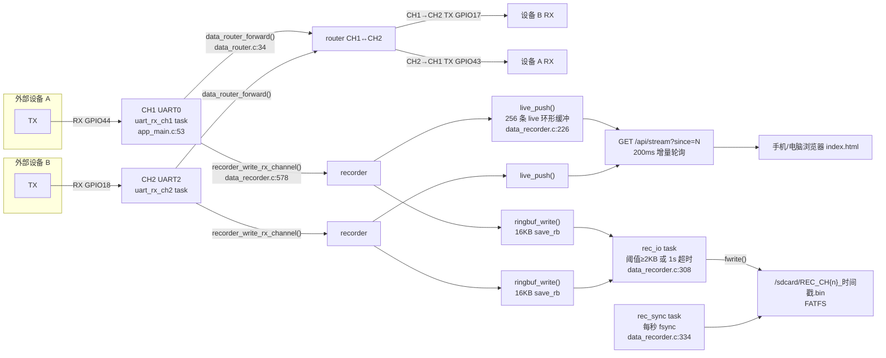
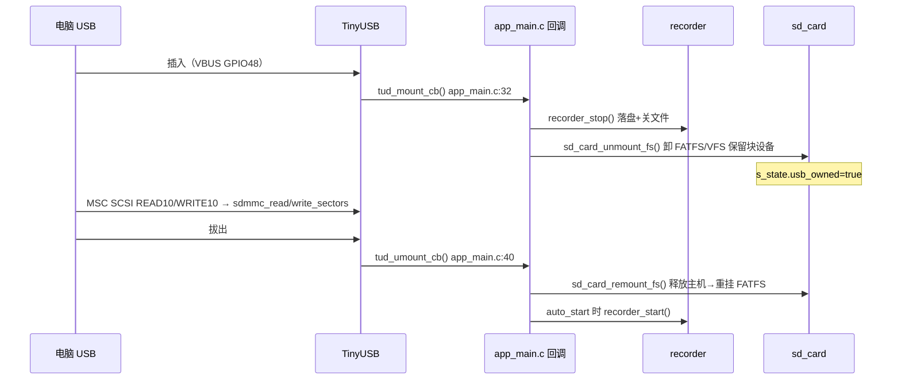
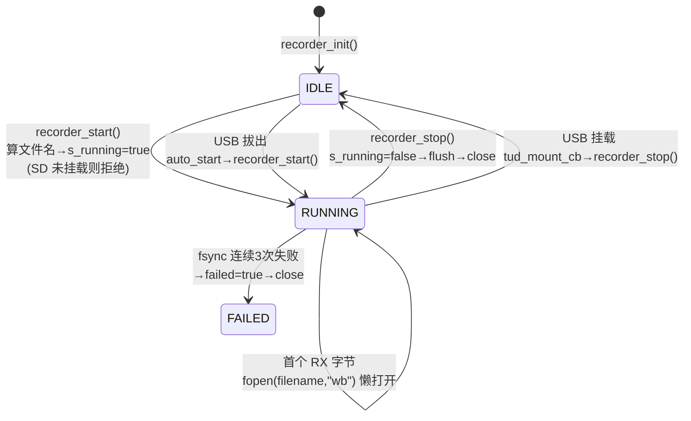

# 02 · 系统架构（真实分层 + 数据流 + 任务关系 + 状态机）

> 所有图按 v1.2 实际代码绘制。源码证据标注 `文件:行号`。

## 一、分层视图（硬件 → 驱动 → 服务任务 → 对外接口）

```
┌────────────────────────────────────────────────────────────┐
│ 对外接口层                                                  │
│  Web (http://192.168.4.1)   USB CDC(虚拟串口)  USB MSC(U盘) │
│  Flutter App(仓库无源码)                                     │
├────────────────────────────────────────────────────────────┤
│ 服务/任务层（FreeRTOS）                                      │
│  uart_rx_ch1  uart_rx_ch2  rec_io  rec_sync  tinyusb        │
│  + httpd task(esp_http_server 自建)  + console REPL task     │
├────────────────────────────────────────────────────────────┤
│ 业务模块层（main/ 组件）                                     │
│  uart_driver  data_recorder  data_router  wifi_config       │
│  web_server   config_manager(NVS+cJSON)  sd_card  usb_*     │
├────────────────────────────────────────────────────────────┤
│ ESP-IDF 驱动层                                              │
│  UART Driver  SDSPI  FATFS(VFS)  esp_wifi  esp_event        │
│  TinyUSB  esp_http_server  NVS  esp_timer  gpio             │
├────────────────────────────────────────────────────────────┤
│ 硬件层（ESP32-S3）                                           │
│  UART0/2 · SPI2(SD) · USB OTG · WiFi RF · NVS Flash         │
└────────────────────────────────────────────────────────────┘
```

- 证据：模块对应关系见 `main/CMakeLists.txt` L1（12 个 .c）；任务创建见 `app_main.c` L182-L193、`data_recorder.c` L396-L403；TinyUSB 任务由组件自建（`sdkconfig` `CONFIG_TINYUSB_TASK_PRIORITY=5`/`STACK_SIZE=4096`/`AFFINITY_CPU1`）。

## 二、数据流全景（Mermaid，按 data_recorder.c / data_router.c / web_server.c）



- 关键点：TX 方向只进 live 显示、**不落盘**（`data_recorder.c` L589-L597 `recorder_write_tx_channel` 仅 `live_push`，注释 `data_recorder.h` L15 "TX 只进入实时显示"）。`/api/send` 发 TX 时经 `user_uart_set_tx_callback(recorder_write_tx_channel)` 回到 live（`app_main.c` L136）。

## 三、USB 热插拔数据流（SD 卡所有权状态切换）



- 证据：`app_main.c` L32-L51；`sd_card.c` L123-L167；`usb_msc.c` L109-L161。

## 四、FreeRTOS 任务关系图（Mermaid）

```mermaid
flowchart TB
    MAIN["app_main / main task<br/>(栈 3584, sdkconfig)"]
    MAIN -->|xTaskCreate| U1["uart_rx_ch1 (prio5, 4096)"]
    MAIN -->|xTaskCreate| U2["uart_rx_ch2 (prio5, 4096)"]
    MAIN -->|recorder_init()| IO["rec_io (prio5, 4096)"]
    MAIN -->|recorder_init()| SY["rec_sync (prio1, 3072)"]
    MAIN -->|tinyusb_driver_install| TU["tinyusb (prio5, 4096, CPU1)"]
    MAIN -->|web_server_start| HT["httpd task (栈 16384)"]
    MAIN -->|console_start| CT["console REPL task"]

    U1 -->|"recorder_write_rx_channel"| IO
    U2 -->|"recorder_write_rx_channel"| IO
    IO -->|"xSemaphoreGive(s_data_sem)"| IO
    SY -->|"vTaskDelay 1s"| SY
    HT -->|"handler → recorder_start/stop"| IO
```

- 证据：任务名/优先级/栈见 `app_main.c` L168-L193、`data_recorder.c` L24-L27、`web_server.c` L766-L768（httpd `stack_size=16384`）、`sdkconfig` L2094-L2099（tinyusb）。
- 互斥/同步对象：`s_mutex`（recorder 状态+缓冲）、`s_data_sem`（rec_io 唤醒）、`s_live_mutex`（live 缓冲）、`s_state_lock`（UART 计数器 portMUX）、`s_stats_lock`（router 统计 portMUX）、`s_wifi_event_group`（WiFi EventGroup）。证据：`data_recorder.c` L48-L57、`uart_driver.c` L10、`data_router.c` L12、`wifi_config.c` L22。

## 五、记录状态机（data_recorder.c 实态）



- 证据：`data_recorder.c` L514-L552（start，L516 校验 SD mounted、L523 幂等）、L554-L576（stop）、L334-L366（sync 失败关闭）、`app_main.c` L32-L51（USB 触发 stop/start）。

## 六、启动时序（app_main 初始化顺序，v1.2 容错版）

1. `gpio_config(GPIO16)` 拉低（串口接收使能）— `app_main.c` L73-L81
2. `nvs_flash_init()`（失败则 erase 重试）— L83-L89
3. `sd_card_init()`（**失败不中止**，仅记 warning）— L92-L94
4. `usb_cdc_init()` / `usb_msc_init()`（失败不中止）— L97-L102
5. `config_manager_load("/sdcard/config.json")`（NVS 优先）— L105-L113
6. `recorder_init()`（失败不中止）— L115-L117
7. `user_uart_init_channel()` ×2（逐通道独立，失败仅标记不 ready）— L120-L135
8. `user_uart_set_tx_callback(recorder_write_tx_channel)` — L136
9. `data_router_init()` — L137
10. `wifi_config_init()` + `wifi_apply_ap()` — L140-L145
11. `web_server_start()` — L147-L149
12. 可选 `wifi_connect_sta()` — L151-L154
13. 可选 `recorder_start()`（auto_start）— L156-L166
14. `xTaskCreate(uart_rx_task)` ×2 — L182-L193
15. `console_start()` — L194

> v1.2 与 v1.1 的关键差异：SD/USB/recorder/WiFi/Web 初始化失败从 `ESP_ERROR_CHECK`（abort）改为**记日志降级**，保证"没插 SD 也能用 WiFi/Web"（`app_main.c` L92-L94 注释明说）。
