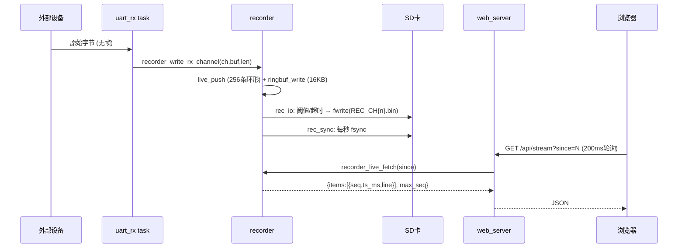

# 05 · 协议与数据流（全部从代码取证）

## 0. 一句话结论

v1.2 的"协议"本质是 **原始字节透传 + 一套轻量 HTTP JSON API + 一条 live 文本流**，**没有**自定义二进制帧协议、没有 WebSocket、没有时间同步/CDC 测试协议（那两项在 v1.3，源码缺失）。

---

## 1. UART 透传帧

- **协议类型**：**无帧**。UART 收到多少字节原样转发/落盘多少字节，不解析、不加头尾、不做分包重组。
- **证据**：`app_main.c` L60-L66 `user_uart_read_channel(channel, buf, 256, 100)` → `recorder_write_rx_channel` + `data_router_forward`；`data_router.c` L56 `user_uart_write_channel(target, data, len)`（整段透传）。
- **落盘格式**：raw 二进制 `.bin`，无文件头、无时间戳内嵌。证据：`data_recorder.h` L14 "无文件头和时间戳"。
- **面试追问点**："如果两个设备之间有 Modbus/自定义协议，你怎么处理分包？" → 当前实现是纯透传，**不做** Modbus 解析（需求 `docs/ESP32.md` 只要求"监控维特 IMU 发送信息 / 双向透传"，未要求协议解析）。

## 2. 实时流（live stream）文本协议

- **格式**：`ISO时间戳,CH{n},{RX|TX},{HEX字节空格分隔}\n`
- **实例**：`2026-07-27T19:34:28.123,CH1,RX,01 03 00 00 00 0A C5 CD`
- **证据**：`data_recorder.c` L249-L259 `snprintf(slot->line, ..., "%s,CH%u,%s,", timestamp, channel, dir_str)` 后逐字节 `%02X`；`LIVE_CHUNK_BYTES=48`（每行最多 48 字节 HEX）；单行上限 `RECORDER_LIVE_LINE_MAX=160`（`data_recorder.h` L22）。
- **结构体**：`recorder_live_item_t { uint32_t seq; uint32_t ts_ms; char line[160]; }`（`data_recorder.h` L25-L29）。
- **传输**：`GET /api/stream?since=N` 增量拉取，返回 `{"items":[{"seq":..,"ts_ms":..,"line":".."}],"max_seq":N}`（`data_recorder.c` L609-L634 `recorder_live_fetch`，只返回 `seq > since_seq` 的条目）。
- **容量**：256 条环形缓冲，满了覆盖最旧（`data_recorder.c` L53-L56、L267-L270）。

## 3. Web REST API（HTTP JSON 协议）

> 完整 22 路由见 `web_server.c` L776-L797。以下列代表性协议细节。

### 3.1 状态接口 `GET /api/status`

- **返回**：~40 字段 JSON（`web_server.c` L115-L212），含 `ap/ap_ssid/ap_ip/sta_connected/sta_ssid/sta_ip/sd/sd_usb_owned/file_api_available/recording/file_open/stream_gap_ms/uart_baudrate/recorder_auto_start/rec_drop_count/rec_total_bytes/ch1_* /ch2_* /uart_ch1_* /route_* /uptime/free_heap/fw_version/usb_mode/current_file`。
- **证据**：`status_handler` 逐一 `cJSON_Add*`。

### 3.2 发送接口 `POST /api/send`

- **请求体**：`{"channel":1,"hex":"01 03 00 00 00 0A"}`（`send_tx_handler` L565）。
- **处理**：HEX 字符串 → 二进制字节 → `user_uart_write_channel` → 返回 `{"ok":true,"channel":1,"sent":N}`。
- **证据**：`build_report_docx.py` L390-L400 摘录；`web_server.c` L565。

### 3.3 记录控制 `POST /api/recorder/start|stop`

- **语义**：start→`recorder_start()`（算文件名，SD 未挂载返回错误）；stop→`recorder_stop()`（flush+fsync+fclose）。

### 3.4 文件管理 `GET /api/files` / `GET /api/file?name=` / `POST /api/file/delete?name=`

- **安全**：`is_safe_filename`（拒绝 `/ \ :` 与 `..`）——`web_server.c` L50-L58、L468/L496。
- **下载**：`Content-Disposition: attachment; filename="..."` + `httpd_resp_send_chunk` 分块（L479-L489）。

### 3.5 配置 `POST /api/config/{uart,router,recorder,stream_gap}`

- **语义**：改内存配置 → `config_manager_save`（NVS + SD 镜像）→ 失败回滚。证据：`config_manager.c` L387-L424 各 setter + `save_or_rollback`。

### 3.6 WiFi `POST /api/wifi` / `GET /api/wifi/scan|status` / `POST /api/wifi/disconnect` / `POST /api/ap`

- **语义**：STA 配网（SSID/密码/authmode）→ 存配置 + `wifi_connect_sta`；AP 改参 → `wifi_apply_ap`。

### 3.7 重启 `POST /api/reboot`

- **语义**：`esp_restart()`，带延时保证响应发出。

---

## 4. WebSocket —— 任务书要求但未实现

- `docs/=任务.txt` L218-L228 要求 `WebSocket /ws`（消息 `uart_rx/uart_tx/system_log/status/record_status`）。
- **实际**：v1.2 `web_server.c` 无 WebSocket 路由，实时数据用 **200ms 增量轮询**替代（`data_recorder.c` `recorder_live_fetch` + 前端 `pollStream` 每 200ms）。
- **面试说辞**：这是"任务书 vs 实际落地"的显性差异，可讲权衡——轮询实现简单、无长连接状态管理、局域网低延迟够用；WebSocket 更省带宽但需引入 ws 握手/心跳/断线重连复杂度。

## 5. SD 文件命名规则（落盘产物协议）

- **规则**：`/sdcard/REC_CH{1|2}_YYYYMMDD_HHMMSS.bin`，同秒冲突自动加 `_1/_2/.../_9999` 后缀。
- **证据**：`data_recorder.c` L157-L177 `recorder_compute_filename_locked`（`for suffix 0..9999`，`stat()` 判存在）。
- **实例**：`REC_CH1_20260727_193428.bin` → `REC_CH1_20260727_193428_1.bin`（`docs/ESP_Recorder_项目开发完整报告.md` L487-L491）。

## 6. 配置持久化协议（config.json）

- **存储**：NVS（namespace `recorder_cfg`，key `config_json`）为主，`/sdcard/config.json` 为镜像。
- **JSON schema**（v1.2，`config_manager.c` L141-L165 `build_json`）：
  ```json
  {
    "schema_version": 2,
    "uart":     {"baudrate":115200,"databits":8,"stopbits":1,"parity":0},
    "wifi":     {"enable_ap":true,"ap_ssid":"","ap_pass":"12345678","ap_ip":"192.168.4.1",
                 "enable_sta":false,"sta_ssid":"","sta_pass":"","sta_authmode":0},
    "recorder": {"auto_start":true,"stream_gap_ms":100},
    "router":   {"enabled":true}
  }
  ```
- **校验**：`clamp_authmode`（只允许 OPEN/WPA/WPA2/WPA3/WPA2_WPA3）、`clamp_stream_gap_ms`（1~1000）、`valid_baudrate`（1200~2000000）。

## 7. USB MSC SCSI 协议（U 盘）

- **支持的命令**（`usb_msc.c`）：`INQUIRY`（L41）、`TEST UNIT READY`（L55）、`READ CAPACITY`（L61）、`START STOP`（L69）、`READ10`（L109）、`WRITE10`（L136）、其余回 `SCSI_SENSE_ILLEGAL_REQUEST`（L172-L177）。
- **约束**：READ10/WRITE10 要求 `offset==0` 且 `bufsize % sector_size == 0`（L120/L147）。

## 8. 时间同步协议 / cdc 测试协议 —— 源码缺失

- 二者均为 README 所述 v1.3 功能；**作者自述（【作者实习记录】）v1.3 含 cdc 测试协议 / 时间同步 / 安全测试模式**，但 v1.3 目录为空 gitlink，**源码未入库、无协议定义可取证**【待本人确认】。
- v1.2 时间来源：`gettimeofday` + `localtime_r`（`data_recorder.c` L114-L124），无 SNTP/NTP 同步。
- 面试若被问到，答"这是 v1.3 的迭代目标（作者自述），源码未随本次仓库提交，我可以讲设计思路但无法逐行举证"。

---

## 9. 端到端数据流时序（Mermaid，含协议载体）



- 证据：`app_main.c` L53-L67、`data_recorder.c` L578-L597 / L308-L366 / L609-L634。
