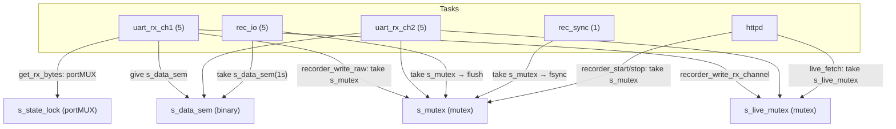

# 06 · FreeRTOS 与并发（任务清单 / 同步原语 / 数据流 / 竞态与背压）

> 全部任务参数与同步原语从代码 + sdkconfig 取证。

## 一、FreeRTOS 任务清单（从 main 与 sdkconfig 取证）

| 任务名 | 优先级 | 栈(字节) | 创建位置 | 功能 | 阻塞方式 |
|---|---|---|---|---|---|
| `uart_rx_ch1` | 5 | 4096 | `app_main.c` L182 | CH1 收数→recorder+router | `uart_read_bytes(100ms)` |
| `uart_rx_ch2` | 5 | 4096 | `app_main.c` L182 | CH2 收数→recorder+router | `uart_read_bytes(100ms)` |
| `rec_io` | 5 | 4096 | `data_recorder.c` L396 | 环形缓冲落盘 | `xSemaphoreTake(s_data_sem,1s)` |
| `rec_sync` | 1 | 3072 | `data_recorder.c` L400 | 每秒 fsync | `vTaskDelay(1000ms)` |
| `tinyusb` | 5 | 4096 | TinyUSB 组件（sdkconfig） | USB 事件/CDC/MSC | 组件内部 |
| `httpd`（esp_http_server 自建） | — | 16384 | `web_server.c` L768 | 处理 HTTP 请求 | httpd 内部 |
| `console REPL` | — | — | `console_start()`→`esp_console_new_repl_uart` | 命令行 REPL | linenoise |
| `main`（app_main） | — | 3584 | boot | 初始化后死循环 delay | `vTaskDelay(1000)` |

- 证据：任务名 `uart_rx_ch1/ch2` 见 `app_main.c` L168-L171；优先级/栈 `xTaskCreate(...,4096,...,5,...)` L182；`rec_io`/`rec_sync` 宏 `data_recorder.c` L24-L27（`SAVE_TASK_PRIORITY=5`、`SYNC_TASK_PRIORITY=1`）；`CONFIG_FREERTOS_HZ=100`（sdkconfig L1336）；`CONFIG_TINYUSB_TASK_PRIORITY=5`/`STACK_SIZE=4096`/`AFFINITY_CPU1`（sdkconfig L2094-L2099）；`CONFIG_ESP_MAIN_TASK_STACK_SIZE=3584`（sdkconfig L1132）。

> **任务与分工对应（【作者实习记录】）**：`uart_rx_ch1/ch2`（双路接入）、`rec_io`/`rec_sync`（SD 落盘 + fsync）属**本人负责的数据链路侧**；`httpd` 任务承载的 Web 实时监控页主要由**同事（蔡茹锦）**负责，但其数据供给（live 环形缓冲 + `/api/stream`）是本人 `data_recorder.c` 提供的；`tinyusb`/`console` 是框架/工具任务。

## 二、同步原语清单

| 原语 | 变量 | 作用 | 证据 |
|---|---|---|---|
| 互斥量 | `s_mutex` | 保护 recorder 状态/缓冲/文件 | `data_recorder.c` L49/L374 |
| 二进制信号量 | `s_data_sem` | 唤醒 rec_io 落盘 | `data_recorder.c` L50/L375 |
| 互斥量 | `s_live_mutex` | 保护 live 环形缓冲 | `data_recorder.c` L57/L376 |
| 自旋锁(portMUX) | `s_state_lock` | 保护 UART RX/TX 计数器 | `uart_driver.c` L10 |
| 自旋锁(portMUX) | `s_stats_lock` | 保护 router 统计 | `data_router.c` L12 |
| 事件组 | `s_wifi_event_group` | WiFi 连接成功/失败位 | `wifi_config.c` L22/L87 |

- **为什么计数器用 portMUX（自旋锁）而非互斥量**：临界区极短（一条 `+=`），自旋锁开销更小、无阻塞切换。证据：`uart_driver.c` L211-L219 `portENTER_CRITICAL(&s_state_lock); s_rx_bytes[...] += ...; portEXIT_CRITICAL(...)`。

## 三、UART 事件与任务间数据流

- **没有使用 UART 事件队列**（`uart_driver_install(..., queue_size=0, ...)`，`uart_driver.c` L74/L117 第 5 参为 0），而是 RX task 用 `uart_read_bytes` **轮询**。
- **数据流**：`uart_rx_task`（读）→ 直接调用 `recorder_write_rx_channel`（同步写 live + save_rb）+ `data_router_forward`（同步转发）。任务间**无队列中转**，是"函数调用 + 共享缓冲 + 互斥量"模型。
- **rec_io 唤醒**：`recorder_write_raw` 每次写入后 `xSemaphoreGive(s_data_sem)`（`data_recorder.c` L305）。

## 四、竞态分析（从代码可证）

1. **`s_running` 的读写**：均被 `s_mutex` 保护（`recorder_is_running` L410-L418、`recorder_start` L522、`recorder_stop` L560），**无竞态**。
2. **`s_data_sem` 在 s_mutex 释放后才 give**（`data_recorder.c` L304-L305）：
   ```c
   xSemaphoreGive(s_mutex);
   xSemaphoreGive(s_data_sem);
   ```
   潜在问题：rec_io 每次 take 一个信号量后可能处理多通道缓冲，但写入方每写一批就 give 一次，**信号量计数会累加**，最多堆积到"写入次数"量级——不会死锁但属于"信号量语义当通知用"的弱模式（`xSemaphoreTake(s_data_sem, 1s)` 超时兜底了正确性）。
3. **`recorder_get_filename` 无锁读 `state->filename`**（`data_recorder.c` L457-L470）：未持 `s_mutex`，若与 `recorder_start/compute_filename` 并发可能读到半写字符串——**轻微竞态**（实际调用点 `status_handler` 在 httpd 任务里，与 recorder 任务并发）。
4. **WiFi 事件回调里的 `vTaskDelay(5000)`**（`wifi_config.c` L51）：阻塞默认事件循环（同循环还处理其他 IP/WIFI 事件），是**并发/阻塞风险**（`HANDOVER_AUDIT_STAGE1.md` L120 已列）。
5. **HTTP handler 直接做 SD 读写**（`file_download_handler` `fopen/fread`、`config_manager_save` 写文件）：httpd 任务里阻塞 I/O，慢 SD 会拖慢所有 Web 请求（`HANDOVER_AUDIT_STAGE1.md` L120）。

## 五、背压：SD 写慢怎么办

- **问题**：UART 持续高速收数（如 115200bps ≈ 11.5KB/s，两路 ≈ 23KB/s），SD 卡 FATFS 写入有突发阻塞（Flash 擦除、FAT 元数据更新），可能瞬间慢于收数。
- **现有机制（`data_recorder.c`）**：
  1. 16KB 环形缓冲 `save_rb` 吸收突发（每通道）；
  2. 双条件落盘减少写次数；
  3. `rec_io` 单独任务，不阻塞 uart_rx_task；
  4. **丢包显式统计**：`ringbuf_write` 写不下时 `drop_count += (len - written)`（L299-L303），Web 上能看到 `rec_drop_count`。
- **缺口**：uart_rx_task 本身**没有**读侧背压——`uart_read_bytes` 读走就写 recorder，若 save_rb 满则**丢**（计入 drop），不会反压外部设备（无硬件流控，`flow_ctrl=UART_HW_FLOWCTRL_DISABLE`，`uart_driver.c` L57）。
- **面试答法**：承认"当前是丢包统计 + 大缓冲吸收，无流控反压"，给改进方向（加大缓冲 / 触发式写 / 硬件 RTS/CTS / 独立写队列 + 水位通知）。

## 六、优先级设计讨论

- **uart_rx 与 rec_io 同为 5**：收数与落盘同优先级，靠信号量让出 CPU；极端情况下 rec_io 抢不过两个 uart_rx 会饿死，但 `rec_sync`（优先级 1）每秒兜底 flush，保证数据最终落盘。
- **rec_sync 最低（1）**：fsync 是重操作，放在最低优先级避免抢 CPU；`recorder_sync_task` 里先 `recorder_flush_all_locked()` 再 fsync（L341-L363），等于"每秒强制落盘一次"。
- **tinyusb 优先级 5 且 CPU1 亲和**：USB 协议栈需要低延迟响应 SCSI/CDC 事件，亲和 CPU1 隔离出专用核处理（`sdkconfig` L2098）。

## 七、Mermaid：并发关系与锁


